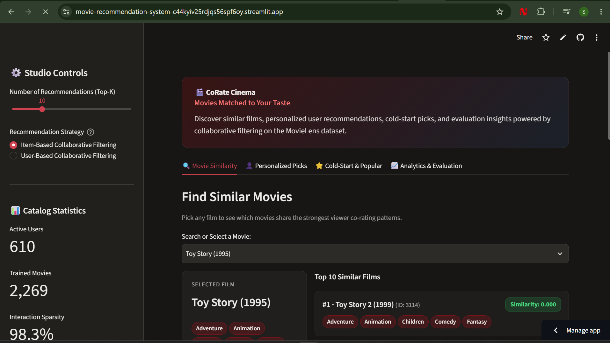

# 🎬 CoRate Cinema — Movies Matched to Your Taste

An end-to-end, modular Movie Recommendation Engine built with Python, Pandas, SciPy, Scikit-learn, and Streamlit using the **MovieLens Latest Small** dataset.

The application analyzes historical user ratings, calculates item and user similarities, predicts user preferences on unrated movies, and handles cold-start users with Bayesian popularity fallbacks.

## 🔗 Live Links & Demo

* **Live App (Streamlit):** [https://movie-recommendation-system-c44kyiv25rdjqs56spf6oy.streamlit.app](https://movie-recommendation-system-c44kyiv25rdjqs56spf6oy.streamlit.app)
* **GitHub Repository:** [https://github.com/srisai1715-coder/movie-recommendation-system](https://github.com/srisai1715-coder/movie-recommendation-system)

## 🎥 Application Preview



## 📌 1. Project Overview

**CoRate Cinema** implements a personalized collaborative filtering recommendation engine. The system analyzes historical user ratings, calculates vector similarities between items and users, predicts user preferences on unrated movies, handles cold-start users with Bayesian popularity fallbacks, and serves real-time recommendations through an interactive Streamlit web application.

### Key Highlights

* **Clean Modular Architecture**: Clear separation between data loading, preprocessing, similarity calculation, recommendation algorithms, evaluation, model serving, and UI.
* **Sparse Matrix Operations**: Uses `scipy.sparse.csr_matrix` to handle $98.3\%$ rating sparsity efficiently and speed up similarity and dot-product calculations.
* **No Data Leakage**: Enforces strict train-test isolation so withheld test ratings are never used during similarity computation or model fitting.
* **Dual Collaborative Filtering**:
  * **Item-Based CF**: Movie-to-movie cosine similarity with rating weighting.
  * **User-Based CF**: User-to-user similarity with peer neighborhood aggregation.
* **Cold-Start Fallback**: IMDb-style Bayesian Weighted Rating computed on training data for new users (`>610`) and sparse items.
* **Comprehensive Evaluation**: Benchmarked across RMSE, MAE, Precision@10, Recall@10, and Catalog Coverage.
* **Interactive Web Interface**: Streamlit dashboard featuring **Movie Similarity**, **Personalized Picks**, **Cold-Start & Popular**, and **Analytics & Evaluation**.

## 🧱 2. Project Architecture

```text
movie-recommendation-system/
│
├── .streamlit/                     # Streamlit theme configuration
│   └── config.toml                 # CoRate Cinema theme colors
│
├── assets/                         # UI screenshots and README media
│   └── corate-cinema-ui.png        # Live CoRate Cinema interface screenshot
│
├── dataset/                        # MovieLens dataset CSVs and train/test splits
│   ├── movies.csv                  # Movie catalog (movieId, title, genres)
│   ├── ratings.csv                 # User ratings (userId, movieId, rating, timestamp)
│   ├── tags.csv                    # User tags
│   ├── links.csv                   # IMDb/TMDb links
│   ├── train_ratings.csv           # Training partition (80%)
│   ├── test_ratings.csv            # Held-out test partition (20%)
│   └── processed_movies.csv        # Cleaned and filtered movie catalog
│
├── notebooks/                      # Step-by-step Jupyter Notebooks
│   ├── 01_data_exploration.ipynb
│   ├── 02_data_preprocessing.ipynb
│   ├── 03_item_based_filtering.ipynb
│   ├── 04_user_based_filtering.ipynb
│   └── 05_model_evaluation.ipynb
│
├── src/                            # Modular Python source code
│   ├── __init__.py
│   ├── data_loader.py              # Data ingestion and summary stats
│   ├── preprocessing.py            # Cleaning, filtering, CSR sparse matrix, splitting
│   ├── similarity.py               # Item and user cosine similarity calculations
│   ├── recommender.py              # MovieRecommender class (Item-based, User-based, Cold-start)
│   ├── evaluation.py               # RMSE, MAE, Precision@K, Recall@K, Catalog Coverage
│   ├── model_training.py           # Training pipeline and artifact serialization
│   └── visualizations.py           # High-resolution charts with Matplotlib & Seaborn
│
├── models/                         # Serialized model artifacts
│   └── recommender_model.joblib    # Trained model artifact (~17–18 MB)
│
├── visualizations/                 # Generated diagnostic and exploratory charts
│   ├── 01_rating_distribution.png
│   ├── 02_most_rated_movies.png
│   ├── 03_highest_rated_movies.png
│   ├── 04_user_activity.png
│   ├── 05_movie_popularity.png
│   ├── 06_similarity_scores.png
│   └── 07_model_evaluation_comparison.png
│
├── app/                            # Interactive Web App
│   └── streamlit_app.py            # CoRate Cinema Streamlit application
│
├── tests/                          # Automated unit test suite
│   └── test_recommender.py         # Unit tests covering core components
│
├── requirements.txt                # Project dependencies
├── README.md                       # Project documentation
├── main.py                         # Single-command end-to-end runner
└── create_notebooks.py             # Notebook generator script
```

## 🛠️ 3. Technology Stack

* **Language**: Python 3.10+
* **Data Manipulation**: Pandas, NumPy
* **Sparse Computations**: SciPy (`scipy.sparse.csr_matrix`)
* **Machine Learning**: Scikit-learn (`sklearn.metrics.pairwise.cosine_similarity`)
* **Data Visualization**: Matplotlib, Seaborn
* **Model Serialization**: Joblib
* **Testing**: Pytest
* **Notebooks**: Jupyter / nbformat
* **Web Interface & Hosting**: Streamlit & Streamlit Community Cloud

## 🚀 4. Quickstart & Setup Instructions

### Step 1: Navigate to Your Project Folder

```powershell
cd "C:\Users\srisa\Downloads\movie-recommendation-system"
```

### Step 2: Create & Activate a Python Virtual Environment

```powershell
python -m venv venv
.\venv\Scripts\Activate.ps1
```

### Step 3: Install Required Dependencies

```powershell
python -m pip install -r requirements.txt
```

### Step 4: Run the Complete End-to-End Pipeline

```powershell
python main.py
```

This runs the full pipeline:

1. Loads MovieLens data.
2. Cleans and partitions data ($80\%$ train, $20\%$ test).
3. Fits Item-Based and User-Based Collaborative Filtering models.
4. Benchmarks performance on held-out test data.
5. Saves the trained model artifact to `models/recommender_model.joblib`.
6. Generates 7 visual charts into `visualizations/`.
7. Demonstrates live recommendations for users, similar movies, and cold-start users.

### Step 5: Run Automated Unit Tests

```powershell
python -m pytest -v
```

### Step 6: Launch the Streamlit Web Application Locally

```powershell
python -m streamlit run app/streamlit_app.py
```

Open your browser at `http://localhost:8501` to interact with **CoRate Cinema**.

## 📐 5. Mathematical Concepts & Formulas

### 1. Matrix Sparsity

Most users have rated a small fraction of all movies.

$$
\text{Sparsity} = \left(1 - \frac{\text{Total Ratings}}{\text{Unique Users} \times \text{Unique Movies}}\right) \times 100\% = 98.3\%
$$

### 2. Item-to-Item Cosine Similarity

Cosine of the angle between two movie rating vectors across users:

$$
\cos(\mathbf{r}_i, \mathbf{r}_j) = \frac{\mathbf{r}_i \cdot \mathbf{r}_j}{\Vert{}\mathbf{r}_i\Vert{}_2 \Vert{}\mathbf{r}_j\Vert{}_2} = \frac{\sum_u r_{u,i} r_{u,j}}{\sqrt{\sum_u r_{u,i}^2} \sqrt{\sum_u r_{u,j}^2}}
$$

### 3. Item-Based Rating Prediction

Predicted score $\hat{r}_{u,i}$ for user $u$ on unrated movie $i$:

$$
\hat{r}_{u,i} = \frac{\sum_{j \in R(u)} s_{i,j} \cdot r_{u,j}}{\sum_{j \in R(u)} \vert{}s_{i,j}\vert{}}
$$

where $R(u)$ is the set of movies rated by user $u$, and $s_{i,j}$ is the cosine similarity between item $i$ and item $j$.

### 4. User-Based Rating Prediction

Predicted score using peer neighborhood $N_i(u)$ (users similar to $u$ who rated $i$):

$$
\hat{r}_{u,i} = \bar{r}_u + \frac{\sum_{v \in N_i(u)} s_{u,v} \cdot (r_{v,i} - \bar{r}_v)}{\sum_{v \in N_i(u)} \vert{}s_{u,v}\vert{}}
$$

### 5. IMDb Bayesian Weighted Rating (Cold-Start Fallback)

For new users with no rating history, **CoRate Cinema** falls back to Bayesian popularity computed from training data:

$$
\text{WR} = \left(\frac{v}{v + m}\right) R + \left(\frac{m}{v + m}\right) C
$$

where:

* $v$: Number of ratings received by the movie
* $m$: Minimum ratings threshold cutoff
* $R$: Average rating of the movie
* $C$: Catalog baseline rating

## 📊 6. Model Evaluation Benchmark

Evaluated on the held-out test partition ($20\%$):

| Model Strategy | RMSE (Stars) | MAE (Stars) | Precision@10 | Recall@10 | Catalog Coverage (%) |
| :--- | :---: | :---: | :---: | :---: | :---: |
| **Item-Based CF** | **0.9193** | **0.7021** | 0.63% | 0.29% | 11.86% |
| **User-Based CF** | 1.1666 | 0.9820 | **1.87%** | **1.15%** | **20.10%** |

### Key Analytical Takeaways

1. **Rating Accuracy**: **Item-Based CF** achieves lower error ($\text{RMSE} = 0.9193$ vs $1.1666$ for User-Based CF) because movie similarity vectors across active raters are more stable than individual user rating patterns.
2. **Catalog Diversity & Discovery**: **User-Based CF** achieves higher catalog coverage ($20.10\%$ vs $11.86\%$) because peer users surface a wider range of items.
3. **Relevance Cutoff ($r \ge 3.5$)**: Ratings $\ge 3.5$ on the $0.5\text{–}5.0$ star scale represent positive relevance for top-$K$ ranking metrics.

## 🖼️ 7. Generated Visualizations

The pipeline generates 7 charts in `visualizations/`:

1. `01_rating_distribution.png`: Frequency distribution of ratings from $0.5$ to $5.0$ stars with percentages.
2. `02_most_rated_movies.png`: Horizontal bar plot of the most-rated movies in MovieLens.
3. `03_highest_rated_movies.png`: Highest-rated movies meeting the minimum rating threshold.
4. `04_user_activity.png`: User rating activity spread and dispersion.
5. `05_movie_popularity.png`: Long-tail distribution of movie popularity.
6. `06_similarity_scores.png`: Cosine similarity heatmap between iconic movies.
7. `07_model_evaluation_comparison.png`: Side-by-side performance comparison of Item-Based vs. User-Based CF.

## 🧪 8. Unit Testing Suite

Automated tests in `tests/test_recommender.py` run via `pytest` to validate:

* Dataset loading, summary stats, and sparsity calculation
* Rating cleaning, range validation ($[0.5, 5.0]$), and minimum rating filtering
* Train-test split isolation and sparse user-item matrix construction
* Cosine similarity matrix properties and Item-Based / User-Based recommendations
* Exclusion of already-watched movies and cold-start fallback for unseen user IDs
* Item-to-item similarity lookup, evaluation metrics (RMSE, MAE, catalog coverage), and model save/load consistency

## 👨‍💻 9. Author & License

Developed by **Sri Sai Telukuntla** as an end-to-end machine learning project.  
Dataset provided by GroupLens Research, University of Minnesota.  
Licensed under the MIT License.